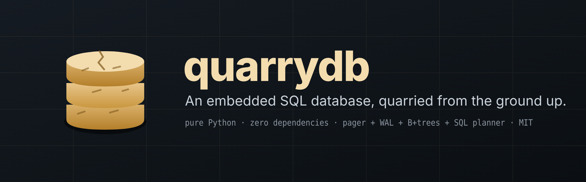
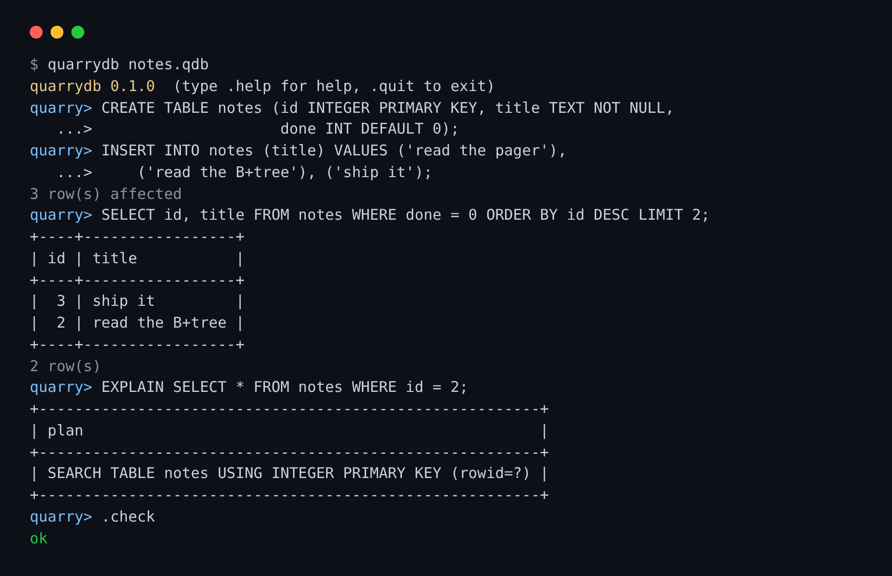
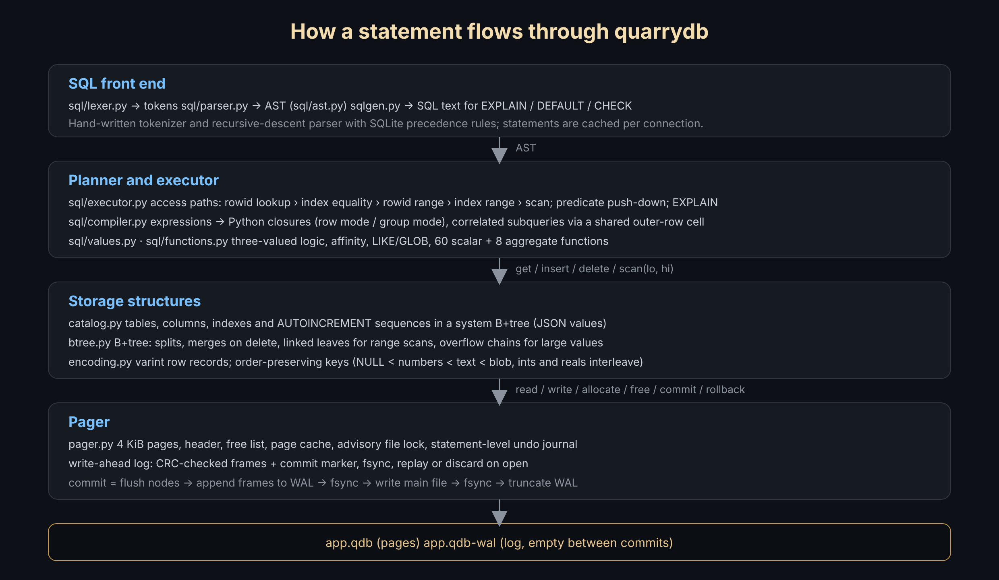

<p align="center"></p>

# quarrydb

**An embedded SQL database written from scratch in pure Python. One file, zero dependencies, every layer readable.**

quarrydb is a complete relational database engine built from the ground up to show how a database actually works: a page file with a free list, a write-ahead log with crash recovery, B+trees with overflow pages, order-preserving key encoding, a hand-written SQL lexer and parser, a planner that picks indexes, a closure-compiling expression evaluator, joins, aggregates, subqueries, transactions with statement-level atomicity, and a shell. It speaks a large, SQLite-compatible subset of SQL and is verified against SQLite itself with differential and randomized tests.

It is about 6,000 lines of standard-library Python (plus 1,000 lines of tests), organised so you can read it bottom-up in an afternoon.

```
$ pip install git+https://github.com/Ethos6/quarrydb
$ quarrydb notes.qdb
quarrydb 0.1.0  (type .help for help, .quit to exit)
quarry> CREATE TABLE notes (id INTEGER PRIMARY KEY, title TEXT NOT NULL, done INT DEFAULT 0);
quarry> INSERT INTO notes (title) VALUES ('read the pager'), ('read the B+tree'), ('ship it');
3 row(s) affected
quarry> SELECT id, title FROM notes WHERE done = 0 ORDER BY id DESC LIMIT 2;
+----+-----------------+
| id | title           |
+----+-----------------+
|  3 | ship it         |
|  2 | read the B+tree |
+----+-----------------+
2 row(s)
quarry> EXPLAIN SELECT * FROM notes WHERE id = 2;
+-----------------------------------------------------------+
| plan                                                      |
+-----------------------------------------------------------+
| SEARCH TABLE notes USING INTEGER PRIMARY KEY (rowid=?)    |
+-----------------------------------------------------------+
```

<p align="center"></p>

## Why

Every "build your own database" tutorial stops at a key-value store or a toy `SELECT`. quarrydb keeps going until the result is something you could actually use: durable commits, indexes the planner really uses, `LEFT JOIN`, `GROUP BY ... HAVING`, correlated subqueries, `UNION`, `CASE`, `LIKE`, 60 built-in functions, `VACUUM`, and a REPL. Nothing is hidden behind a library: the bytes on disk, the tree algorithms and the query pipeline are all in this repository.

## Features

| Layer | What is implemented |
|---|---|
| **Storage** | 4 KiB pages (512–64 KiB configurable), header page, linked free list, page cache, advisory file lock |
| **Durability** | Write-ahead log with CRC32-checked frames and commit markers; torn or partial transactions are discarded on open, complete ones are replayed; `fsync` on commit |
| **Transactions** | `BEGIN` / `COMMIT` / `ROLLBACK`, autocommit, context manager, and **statement-level atomicity** (a failed statement inside a transaction is undone without losing the rest of the transaction) |
| **B+tree** | Variable-length keys and values, leaf chaining for range scans, splits, merges on delete, overflow pages for large values, structural `check()` |
| **Encoding** | Compact varint row records; order-preserving key encoding so `bytes` comparison equals SQL ordering, including mixed `INTEGER`/`REAL` keys |
| **Catalog** | Tables, columns, indexes and `AUTOINCREMENT` sequences stored in a system B+tree as JSON |
| **SQL** | `CREATE/DROP TABLE`, `CREATE TABLE AS`, `CREATE/DROP [UNIQUE] INDEX`, `INSERT [OR REPLACE/IGNORE]`, `INSERT ... SELECT`, `UPDATE`, `DELETE`, `SELECT` with `WHERE`, `JOIN` (inner / left / cross / `USING`), `GROUP BY`, `HAVING`, `ORDER BY` (`NULLS FIRST/LAST`), `LIMIT/OFFSET`, `DISTINCT`, `UNION [ALL]` / `INTERSECT` / `EXCEPT`, `VALUES`, derived tables, scalar / `IN` / `EXISTS` subqueries (correlated too), `CASE`, `CAST`, `BETWEEN`, `LIKE` / `GLOB` with `ESCAPE`, `IS [NOT]`, `EXPLAIN`, `VACUUM` |
| **Constraints** | `PRIMARY KEY` (incl. composite and `INTEGER PRIMARY KEY` rowid alias), `UNIQUE`, `NOT NULL`, `CHECK`, `DEFAULT`, `AUTOINCREMENT` |
| **Planner** | Rowid lookups, index equality (longest matching prefix, unique preferred), index and rowid range scans, index-driven joins, predicate push-down through joins, `ORDER BY` satisfied by index order, early termination for `LIMIT` |
| **Functions** | 60 scalar functions (string, math, type, date/time), aggregates `COUNT`, `SUM`, `TOTAL`, `AVG`, `MIN`, `MAX`, `GROUP_CONCAT` with `DISTINCT` |
| **Types** | `NULL`, `INTEGER`, `REAL`, `TEXT`, `BLOB` with SQLite-style type affinity and comparison rules |
| **Tooling** | Python API in the spirit of `sqlite3`, interactive shell with table/csv/json/line modes, `.dump`, `.check` integrity verification, `python -m quarrydb` |

## Install

Python 3.8+ and nothing else.

```bash
pip install git+https://github.com/Ethos6/quarrydb
# or just copy the quarrydb/ folder into your project
```

## Python API

```python
import quarrydb

db = quarrydb.connect("app.qdb")          # or ":memory:"

db.execute("""
    CREATE TABLE users (
        id    INTEGER PRIMARY KEY,
        email TEXT NOT NULL UNIQUE,
        age   INTEGER CHECK (age >= 0),
        plan  TEXT DEFAULT 'free'
    )
""")
db.executemany("INSERT INTO users (email, age) VALUES (?, ?)",
               [("ada@example.org", 36), ("linus@example.org", 55)])

for row in db.execute("SELECT id, email FROM users WHERE age > :min ORDER BY age", {"min": 40}):
    print(row)                             # (2, 'linus@example.org')

with db:                                   # commit on success, rollback on exception
    db.execute("UPDATE users SET plan = 'pro' WHERE id = 1")

cur = db.execute("SELECT plan, COUNT(*) AS n FROM users GROUP BY plan")
print(cur.columns, cur.fetchall())         # ['plan', 'n'] [('free', 1), ('pro', 1)]

print(db.tables(), db.schema("users"), db.integrity_check())
db.close()
```

* `connect(path, page_size=4096, fsync=True)` → `Connection`
* `Connection.execute(sql, params=None)` → `Cursor` (iterable, `fetchone/fetchmany/fetchall`, `columns`, `description`, `rowcount`, `lastrowid`)
* `executemany`, `executescript`, `begin`, `commit`, `rollback`, `in_transaction`, `close`
* `tables()`, `indexes()`, `schema()`, `columns()`, `iterdump()`, `integrity_check()`, `vacuum()`
* Positional `?` / `?N` and named `:name` parameters
* Exceptions: `DatabaseError` → `SQLError` (syntax), `ProgrammingError` (semantic), `IntegrityError` (constraints), `CorruptionError`, `LockError`

## Shell

```
quarrydb [database] [-c SQL]... [--mode table|csv|json|line|list]
```

Dot-commands: `.tables`, `.schema [TABLE]`, `.indexes`, `.mode`, `.headers`, `.timer`, `.dump`, `.read FILE`, `.open FILE`, `.stats`, `.check`, `.help`, `.quit`. Statements end with `;` and may span lines.

## How it is built

<p align="center"></p>

```
             SQL text
                │
   ┌────────────▼────────────┐
   │  lexer.py  → parser.py  │  tokens → AST (sql/ast.py)
   └────────────┬────────────┘
                │ AST
   ┌────────────▼────────────┐
   │   executor.py           │  planner: access paths, join order, push-down, EXPLAIN
   │   compiler.py           │  expressions → Python closures (row mode / group mode)
   │   functions.py values.py│  built-ins, 3-valued logic, affinity, LIKE
   └────────────┬────────────┘
                │ get / insert / delete / scan(lo, hi)
   ┌────────────▼────────────┐
   │   catalog.py            │  tables, columns, indexes, sequences (a B+tree of JSON)
   │   btree.py              │  B+tree nodes, splits, merges, overflow chains
   │   encoding.py           │  row records, order-preserving keys
   └────────────┬────────────┘
                │ read(pid) / write(pid) / allocate / free / commit / rollback
   ┌────────────▼────────────┐
   │   pager.py              │  page file, free list, cache, statement journal,
   │                         │  write-ahead log, crash recovery, fsync, file lock
   └─────────────────────────┘
```

Read the code bottom-up, in this order: `encoding.py` → `pager.py` → `btree.py` → `catalog.py` → `sql/lexer.py` → `sql/parser.py` → `sql/values.py` → `sql/compiler.py` → `sql/executor.py` → `connection.py`. Each module has a docstring explaining its design. The deeper write-ups:

* [docs/ARCHITECTURE.md](docs/ARCHITECTURE.md): how a statement flows through the engine, how commits are made durable, how the planner chooses an index.
* [docs/FILE_FORMAT.md](docs/FILE_FORMAT.md): the byte layout of the database file, pages, nodes, records, keys and the WAL.
* [docs/SQL.md](docs/SQL.md): the full supported grammar, functions and semantics, and what is intentionally missing.

### Durability in one paragraph

All writes go to an in-memory dirty set. On commit, every dirty page plus the header is appended to `file-wal` as CRC-checked frames followed by a commit frame, and the log is `fsync`ed. Only then are the pages written into the main file, which is `fsync`ed, and the log is truncated. A crash before the commit frame leaves a log that is simply discarded on the next open; a crash after it leaves a log that is replayed. The main file is therefore always a consistent snapshot of some committed transaction. Tests simulate both kinds of crash and a corrupted frame.

### The planner in one paragraph

`WHERE` and `ON` are split into conjuncts; each is pushed to the earliest table in the join order that can evaluate it (conditions on the null-extended side of a `LEFT JOIN` stay after the join). For each table the planner looks for `column = expr` and range predicates whose right-hand side only depends on earlier tables or constants, then picks, in order: rowid equality, the longest-prefix index equality (unique first, with an optional range on the next column), a rowid range, or an index range; otherwise a full scan. Index lookups are widened to catch both `5` and `5.0` and the predicate is re-checked, so results are always exact. `EXPLAIN` prints what was chosen.

## Verification

```bash
python -m unittest discover -s tests -v
```

* **Storage tests**: encoding round-trips and ordering; B+tree randomized against a dict (8k operations with large values and deletes down to empty); overflow chains; free-list reuse; WAL replay after a crash between log and main file; torn log discarded; corrupted frame stops replay; statement journal.
* **SQL tests**: DDL, DML, constraints, joins, subqueries, aggregates, ordering, expressions, compound selects, aliases, index semantics, transactions, persistence across reopen, crash recovery through the SQL layer, `VACUUM`, locking, dump round-trip, CLI.
* **Differential tests against SQLite**: 50+ hand-written queries plus a randomized workload (inserts, updates, deletes, joins, aggregates, reopen, failing statements inside transactions, `VACUUM`) must return exactly what `sqlite3` returns, and `integrity_check()` must stay clean.

## Performance

`python bench/bench.py 50000`, file-backed with `fsync` on, on a typical cloud VM:

| Operation (50,000 rows) | quarrydb | sqlite3 (C) |
|---|---:|---:|
| Insert 50k rows in one transaction | 1.42 s | 22 ms |
| Create index on a text column | 0.46 s | 22 ms |
| 2,000 point lookups by primary key | 84 ms | 9 ms |
| 2,000 point lookups by indexed text | 127 ms | 10 ms |
| Range scan of 5,000 rows | 16 ms | 0.2 ms |
| Full scan with filter | 165 ms | 1.5 ms |
| `GROUP BY` over 50k rows | 200 ms | 9 ms |
| 1,000 autocommit inserts (fsync each) | 747 ms | 635 ms |

That is roughly 35,000 inserts/s, 25,000 indexed lookups/s and 300,000 filtered rows/s from pure Python, 10–100× slower than C SQLite on CPU-bound work and about the same once `fsync` dominates. The engine is honest about being pure Python; it is not trying to replace SQLite in production.

## Limitations (deliberate scope)

* Single process, single writer; no concurrent readers (a file lock refuses a second opener).
* No `ALTER TABLE`, views, triggers, foreign keys, window functions, CTEs, `RIGHT`/`FULL` joins, collations, or savepoints.
* Query results are materialised in memory; sorts and `GROUP BY` are in-memory.
* The file format is versioned but not yet stable across releases.

## Project layout

```
quarrydb/
  encoding.py     records and order-preserving keys
  pager.py        page file, free list, WAL, recovery, statement journal
  btree.py        B+tree
  catalog.py      schema storage
  connection.py   public API, transactions, VACUUM, integrity check
  cli.py          interactive shell
  sql/
    lexer.py parser.py ast.py sqlgen.py
    values.py functions.py compiler.py executor.py errors.py
tests/            unit, SQL, CLI and differential-vs-SQLite tests
bench/bench.py    micro-benchmark
docs/             architecture, file format, SQL reference
```

## License

MIT.
